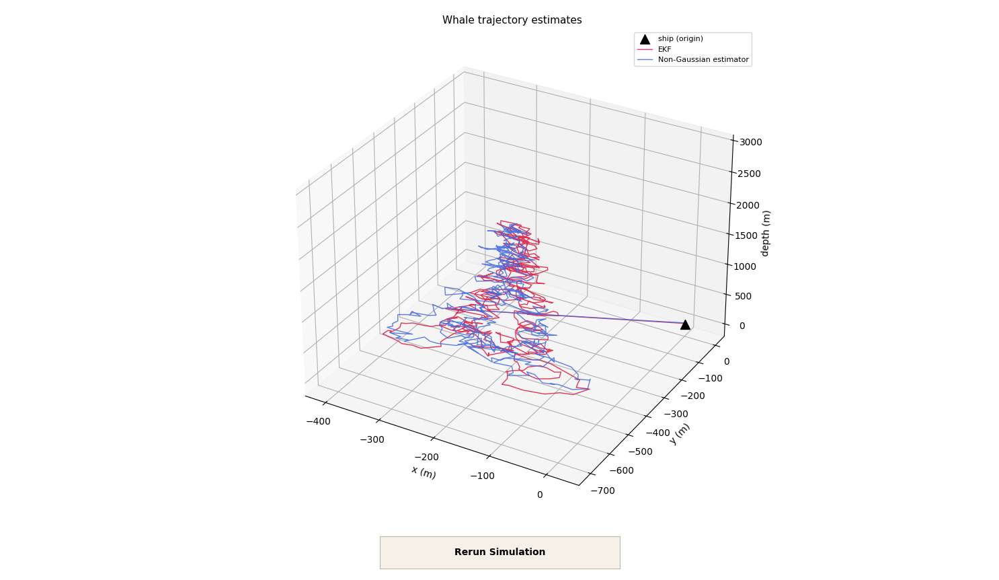
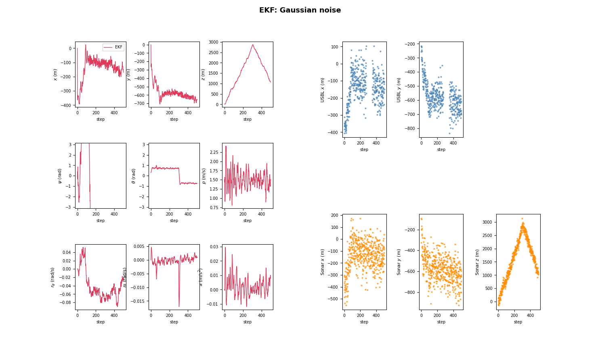
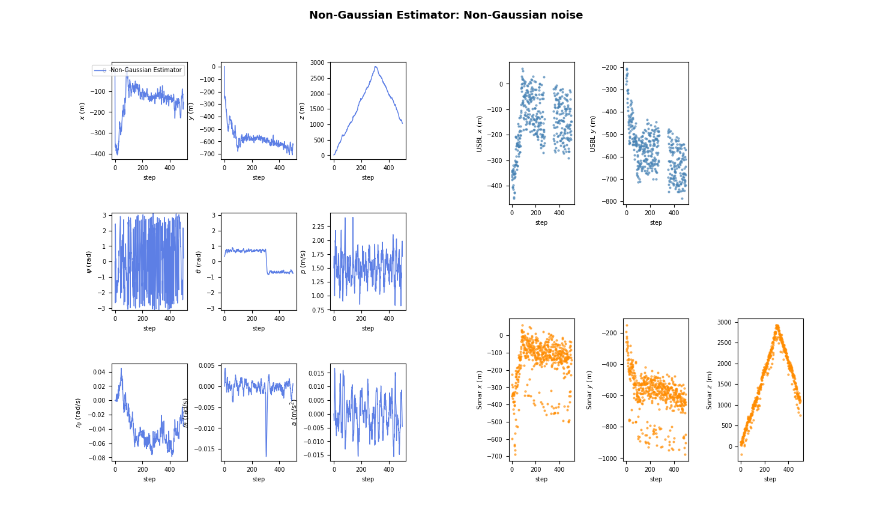

# 🐋 Underwater Whale Tracking: Recursive Estimation 2026

Solution to the programming exercise of the **Recursive Estimation** course (ETH Zürich, Spring 2026).

The goal is to track a diving whale in 3D underwater space using two sensor systems mounted on a surface ship (USBL acoustic positioning + sonar). Two recursive estimators are implemented and compared:

1. **Extended Kalman Filter (EKF)** for the Gaussian noise scenario
2. **Bootstrap Particle Filter (PF)** for the non-Gaussian noise scenario

> **Note:** This repository contains only my own work: the estimator implementations and the documentation. The plots were generated with the course-provided plotting scripts from my own simulation runs. The course framework (simulator, scoring, constants, Docker environment) was provided by the course staff at ETH Zürich (IDSC) and is **not** included.

## Problem Setup

The whale follows a behavioral dynamics model: it dives and then ascends (the target pitch $\theta^*$ flips sign at a fixed fraction of the simulation), cruises towards a target speed, and turns towards a target yaw rate. The **9-dimensional state vector** is:

$$\mathbf{x} = [x,\; y,\; z,\; \psi,\; \theta,\; p,\; r_\psi,\; r_\theta,\; a]^T$$

| State | Description |
|---|---|
| $x, y$ | Horizontal position (m) |
| $z$ | Depth (m), always ≥ 0 |
| $\psi$ | Heading / yaw (rad) |
| $\theta$ | Pitch (rad) |
| $p$ | Forward speed (m/s) |
| $r_\psi, r_\theta$ | Yaw and pitch rates (rad/s) |
| $a$ | Forward acceleration (m/s²) |

The highest-order states $r_\psi, r_\theta, a$ are driven by a known deterministic steering model plus additive zero-mean process noise.

**Sensors:**

- **USBL** measures $x, y$. The noise standard deviation grows linearly with depth, $\sigma_U = \sigma_\text{base} + \alpha z$, and the sensor drops out (`np.nan`) for $z \ge z_\text{drop}$ (2500 m by default).
- **Sonar** measures $x, y, z$ with depth-independent noise, but noisier than the USBL at shallow depth.

**Noise scenarios** (same mean and variance in both):

| | Gaussian scenario | Non-Gaussian scenario |
|:---|:---:|:---:|
| Process noise | Gaussian | Uniform |
| USBL noise | Gaussian | Uniform |
| Sonar noise | Gaussian | Asymmetric bimodal Gaussian mixture ($0.9\,\mathcal{N}_a + 0.1\,\mathcal{N}_b$, $\beta = 0.3$) |

## Results

Results are averaged over 100 Monte Carlo runs, obtained with a locally modified version of the course runner (not included in this repository).

| | EKF | Particle Filter |
|:---|:---:|:---:|
| **Algorithm** | Extended Kalman Filter | Bootstrap SIR |
| **Particles** | n/a | 70,000 |
| RMSE $x$ [m] | 36.60 | 22.42 |
| RMSE $y$ [m] | 36.16 | 21.90 |
| RMSE $z$ [m] | 30.71 | 19.84 |
| RMSE $\psi$ [rad] | 1.374 | 0.921 |
| RMSE $\theta$ [rad] | 0.193 | 0.183 |
| RMSE $p$ [m/s] | 0.511 | 0.439 |
| RMSE $r_\psi$ [rad/s] | 0.0305 | 0.0158 |
| RMSE $r_\theta$ [rad/s] | 0.0046 | 0.0044 |
| RMSE $a$ [m/s²] | 0.0119 | 0.0098 |
| **Mean xyz RMSE** | **34.5 m** | **21.4 m** |
| **Per-step time** | 0.048 ms | 17.6 ms |
| **Timing budget** | 5 ms | 50 ms |
| **Timing score** | 0.999 | 0.989 |

On the respective scenarios, the particle filter reaches about **38% lower mean xyz RMSE** than the EKF, at roughly 370× the computation time per step.

> **Note:** the two filters are run on *different* noise scenarios, so this is not a like-for-like comparison. The lower PF error is consistent with it exploiting the exact bimodal sonar likelihood, but the table alone does not isolate that effect.

### 3D Trajectory Comparison



### EKF: State Estimates & Measurements (Gaussian Noise)



### Particle Filter: State Estimates & Measurements (Non-Gaussian Noise)



## EKF Implementation

Standard textbook EKF with no additional tuning:

- Full nonlinear dynamics with **analytical Jacobian** $A$ (depth clipping is ignored in the prior update and the linearization, as specified in the exercise)
- Process noise enters only the states $r_\psi, r_\theta, a$ through a 9×3 noise Jacobian $L$
- **Adaptive measurement model**: switches between 5 measurements (USBL + sonar) and 3 (sonar only) when the USBL returns NaN
- **State-dependent USBL noise**: the measurement covariance $R$ is evaluated at the current depth estimate
- Kalman gain computed with `np.linalg.solve` for numerical stability
- Initialization: mean at the center of the uniform prior, covariance from the uniform-distribution variance formulas

## Particle Filter Implementation

Bootstrap particle filter (Sequential Importance Resampling) with the following design choices:

| Parameter | Value | Description |
|:---|:---:|:---|
| `N` | 70,000 | Number of particles |
| `BETA_usbl`, `BETA_sonar` | 1.3, 1.3 | Likelihood tempering factors (active USBL / dropout) |
| `K_psi` | 0.005 | Roughening scale for heading |
| `K_ang` | 0.015 | Roughening scale for pitch/speed |
| `resample_frac` | 0.5 | $N_\text{eff}/N$ threshold for resampling |

**Key design choices:**

1. **Fully vectorized NumPy operations**: all 70k particles are propagated in batch
2. **Exact bimodal Gaussian mixture likelihood** for the sonar measurements (constants precomputed)
3. **Likelihood tempering** ($\gamma > 1$, implemented as `BETA_usbl`, `BETA_sonar`): scales log-weights to adjust weight distribution peakiness
4. **Adaptive systematic resampling**, triggered when $N_\text{eff}/N < 0.5$
5. **Post-resampling roughening** with Silverman's kernel rule on $\psi$, $\theta$, $p$ only
6. **Circular mean** for the heading: $\psi = \text{atan2}(\overline{\sin\psi},\; \overline{\cos\psi})$
7. **Physical constraints**: depth clipped to $z \ge 0$, heading wrapped to $[-\pi, \pi]$
8. **Log-domain weight arithmetic** with max-subtraction for numerical stability

## Project Structure

```
├── estimator.py        # Main implementation: EKF & Particle Filter
├── plots/              # Simulation figures
├── LICENSE
└── README.md
```

Only the Python standard library and NumPy are used by the estimator.

## Usage

This repository does not include the course framework. To run the estimators:

1. Download the exercise package from the course website.
2. Replace the provided `estimator.py` with the one from this repository.
3. Run the exercise as described in the course instructions (`bash run.sh` on Linux/macOS, `run.bat` on Windows).

## Disclaimer & License

This repository contains a personal academic solution to a graded course exercise, published for educational and portfolio purposes.

- The course framework files are not part of this repository and remain the intellectual property of their authors (ETH Zürich, Institute for Dynamic Systems and Control).
- The MIT License applies to the contents of this repository (`estimator.py`, documentation and plots).
